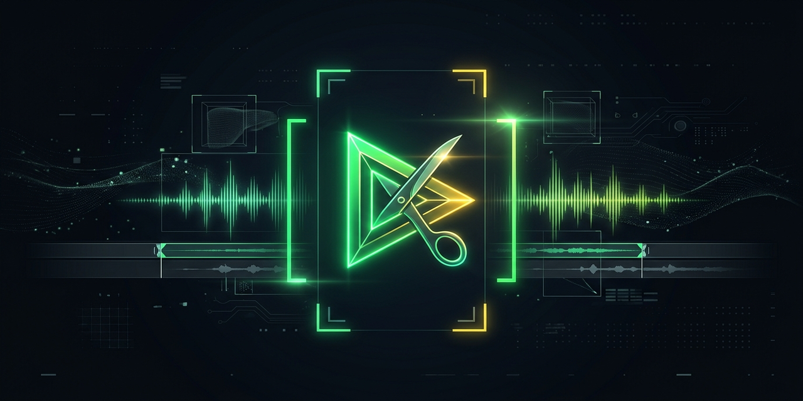
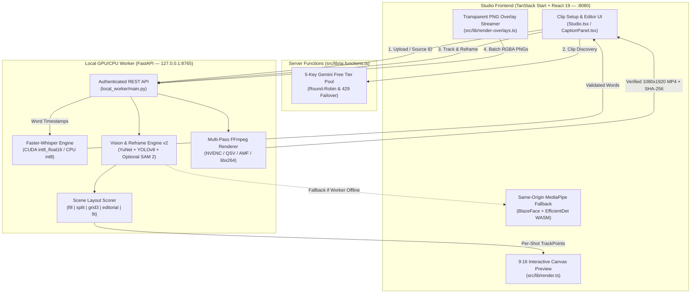
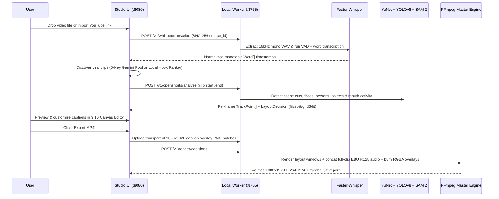

<div align="center">



# ClipForge Studio

**GPU-Accelerated AI Video Clipping, Active-Speaker Tracking & Native FFmpeg Rendering.**

[](https://github.com/2024is008-source/clipforge-studio/actions)
[](https://www.python.org/)
[](https://www.typescriptlang.org/)
[](https://react.dev/)
[](https://ffmpeg.org/)
[](LICENSE)

[Architecture](#architecture) • [Features](#features) • [Installation](#installation) • [Development Setup](#development-setup) • [AI Models](#ai-model-integrations) • [Rendering Pipeline](#rendering-architecture) • [Testing](#testing) • [Documentation](docs/)

</div>

---

## Overview

**ClipForge Studio** is a full-stack, local-first AI short-form video clipping, vertical reframing, and professional mastering platform engineered by **Minuja Ranthika Amarasekara** ([`2024is008-source`](https://github.com/2024is008-source)).

It combines a responsive **TanStack Start + React 19** studio interface with a high-performance **FastAPI + CUDA/QSV/CPU Local Worker** to transform long-form 16:9 videos into broadcast-ready **1080×1920 (9:16)** vertical shorts—complete with local `faster-whisper` word-level transcription, YOLOv8 + OpenCV YuNet multi-person tracking, optional Meta AI SAM 2 segmentation, 5-key Gemini Free Tier clip discovery, and two-pass EBU R128 loudness-normalized FFmpeg mastering.

---

## Features

- **100% Local Speech Transcription**: Powered by `faster-whisper` (CTranslate2) with `int8_float16` CUDA and `int8` CPU execution, word-level timestamps, sub-word BPE continuation merging, and voice activity filtering (`vad_filter`).
- **5-Key Gemini Free Tier Pool + Local Hook Ranker**: Round-robin distribution across up to 5 Google Gemini API keys (`GEMINI_API_KEY_1`..`5`) with automatic HTTP 429 cooldown failover and an offline transcript hook scorer fallback.
- **Hybrid Computer Vision & Active-Speaker Tracking**:
  - **OpenCV YuNet ONNX** face detection + **Ultralytics YOLOv8** person and object detection (`yolov8n.pt`, `yolov8n-pose.pt`).
  - **Optional SAM 2 Segmentation**: Pixel-accurate subject silhouette refinement via `local_worker/segmentation_service.py`.
  - **Mouth + 8 kHz Audio RMS Attribution**: Distinguishes active talkers from silent listeners and cutaway reactions (`local_worker/speaker_priority.py`).
  - **Gimbal Camera Smoothing**: One-Euro trajectory filtering, 3-frame outlier jump rejection, and hard scene-cut snapping.
- **Adaptive 9:16 Layout Engine**: Automatically scores and switches between five vertical compositions per scene with minimum hold-time hysteresis:
  - `fill` — 1-Up Active Speaker 9:16 crop anchored to the upper-third eye line (`0.34`).
  - `split` — 2-Up vertical split-screen for sustained two-shots (`>= 50%` coexistence, non-overlapping crops).
  - `grid3` — 3-Up panel grid for multi-person roundtable and group shots.
  - `editorial` — Context strip + foreground subject stack.
  - `fit` — Full 16:9 frame preserved over a darkened, Gaussian-blurred background bed.
- **Shared Browser & Native FFmpeg Rendering**:
  - Interactive HTML5 Canvas 2D preview (`src/lib/render.ts`) shares exact word timing, phrase pagination, and overlay geometry with the backend FFmpeg renderer (`local_worker/rendering/renderer.py`).
  - Hardware-accelerated H.264 mastering (`h264_nvenc`, `h264_qsv`, `h264_amf`, `h264_videotoolbox`, or `libx264` fallback) with `ffprobe` output verification and SHA-256 checksum generation.

---

## Technology Stack

| Layer | Technologies |
| :--- | :--- |
| **Studio Frontend** | TypeScript 5.8, React 19.2, TanStack Start 1.168, TanStack Router, Tailwind CSS v4.2, Radix UI, Lucide Icons, HTML5 Canvas 2D |
| **Browser Vision Fallback** | MediaPipe Tasks Vision (`@mediapipe/tasks-vision` WASM + local `blaze_face_short_range.tflite` & `efficientdet_lite0.tflite`) |
| **Local Processing Worker** | Python 3.10–3.14, FastAPI, Uvicorn, Pydantic v2 |
| **Speech & Audio** | `faster-whisper` (CTranslate2), FFmpeg two-pass EBU R128 `loudnorm` (`I=-16:TP=-2.0:LRA=11`) |
| **Computer Vision & AI** | Ultralytics YOLOv8, OpenCV (`cv2` + YuNet ONNX), Meta AI SAM 2 (optional), Google GenAI SDK (`@google/genai`) |
| **Video Mastering** | FFmpeg 7.0+ / 9.0 (`h264_nvenc`, `h264_qsv`, `libx264`, `sendcmd`, `ass`, RGBA overlay compositing), `yt-dlp` |
| **Testing & Quality** | Vitest, Testing Library, Python `unittest` & `pytest`, Ruff, ESLint, Prettier, GitHub Actions CI |

---

## Architecture



---

## Video Processing Pipeline



---

## Repository Structure

```text
clipforge-studio/
├── .github/
│   ├── workflows/              # CI, Frontend, Backend, Tests, Security & Release workflows
│   ├── ISSUE_TEMPLATE/         # Bug report & feature request templates
│   ├── PULL_REQUEST_TEMPLATE.md
│   └── FUNDING.yml
├── apps/
│   ├── frontend/               # Frontend studio architectural guide
│   └── backend/                # SSR server functions & auth middleware guide
├── workers/
│   └── local_worker/           # Worker package bridge
├── engines/
│   ├── video/                  # Layout decision & per-video rhythm calibration
│   ├── vision/                 # YOLOv8 object/pose & optional SAM 2 segmentation
│   ├── audio/                  # Faster-Whisper transcription & speaker attribution
│   ├── tracking/               # SpeakerTracker, SmoothedCameraman & OneEuroFilter
│   └── rendering/              # Native FFmpeg multi-pass renderer & QC validator
├── packages/
│   └── contracts/              # Shared TypeScript domain interfaces
├── src/                        # Studio frontend & TanStack Start routes/components
├── local_worker/               # FastAPI worker implementation & rendering modules
├── public/                     # Static assets, custom favicons & local TFLite models
├── docs/
│   ├── audit/                  # INITIAL_AUDIT.md, ARCHITECTURE_AUDIT.md, MIGRATION_PLAN.md, FINAL_VERIFICATION.md, MIGRATION_REPORT.md
│   ├── architecture/           # System architecture & dataflow specifications
│   ├── installation/           # CPU, CUDA, FFmpeg & optional SAM 2 setup guides
│   ├── development/            # Local workflow, scripts & code standards
│   ├── rendering/              # Multi-pass FFmpeg filtergraph & audio seam docs
│   ├── ai-models/              # Whisper, YOLOv8, YuNet, SAM 2 & Gemini key pool docs
│   ├── api/                    # Local Worker HTTP endpoint reference
│   └── troubleshooting/        # Common GPU, port, and codec diagnostics
├── tests/
│   ├── unit/                   # Engine boundary unit tests
│   ├── integration/            # FastAPI worker route & auth integration tests
│   ├── e2e/                    # End-to-end decision-to-filtergraph pipeline tests
│   └── fixtures/               # Deterministic test fixtures
├── assets/
│   └── branding/               # Official ClipForge Studio logos, social preview & SVG diagrams
├── examples/                   # Quickstart Python API usage scripts
├── scripts/                    # Vision asset staging & GitHub publishing scripts
├── README.md
├── CONTRIBUTING.md
├── CODE_OF_CONDUCT.md
├── SECURITY.md
├── SUPPORT.md
├── CHANGELOG.md
└── LICENSE
```

---

## Installation

### Prerequisites
- **Node.js**: `20.19+` or `22.x` (with `npm`)
- **Python**: `3.10` to `3.14` (`3.11` or `3.12` recommended for full CUDA PyTorch compatibility)
- **FFmpeg**: `7.0+` or `9.0` on system `PATH` (with `libx264`, `libass`, and optional `h264_nvenc` / `h264_qsv`)

### 1. Clone the Repository
```bash
git clone https://github.com/2024is008-source/clipforge-studio.git
cd clipforge-studio
```

### 2. Install Frontend Dependencies
```bash
npm install
```

### 3. Install Python Worker Dependencies
```bash
python -m venv .venv
# Windows:
.venv\Scripts\activate
# Linux / macOS:
source .venv/bin/activate

# For NVIDIA CUDA 12.x systems (recommended):
pip install torch torchvision --index-url https://download.pytorch.org/whl/cu126

# Install worker requirements:
pip install -r local_worker/requirements.txt
```

---

## Development Setup

### One-Command Launcher (Windows)
```cmd
run.bat
```
- `run.bat --check` — Verify Node, Python, worker packages, FFmpeg, and port availability.
- `run.bat --stop` — Stop running local worker and studio background processes.
- `run.bat --restart` — Cleanly restart both services.

### Manual Two-Terminal Workflow (Cross-Platform)
```bash
# Terminal 1: Start Local FastAPI Worker (http://127.0.0.1:8765)
python -m local_worker.main

# Terminal 2: Start Studio Frontend (http://localhost:8080)
npm run dev
```

---

## AI Model Integrations

| Model | Purpose | Location / Configuration |
| :--- | :--- | :--- |
| **Faster-Whisper** (`small` default) | Word-timestamp speech recognition | Cached automatically in `MODELS_DIR` (`tiny`, `base`, `small`, `medium`, `large-v3`) |
| **OpenCV YuNet** (`face_detection_yunet_2023mar.onnx`) | Fast frontal & profile face detection | `MODELS_DIR` or `FACE_MODEL_PATH` |
| **Ultralytics YOLOv8** (`yolov8n.pt`, `yolov8n-pose.pt`) | Person, object & pose tracking | `MODELS_DIR` or `YOLO_MODEL_PATH` |
| **Meta AI SAM 2** (`sam2.1_hiera_*.pt`) | Optional pixel-mask subject segmentation | Set `SAM2_MODEL_PATH` & `SAM2_CONFIG` (gracefully skipped if unset) |
| **MediaPipe BlazeFace + EfficientDet** | Same-origin browser vision fallback | Committed in `public/vision/models/*.tflite` |
| **Google Gemini 2.5 Flash** | Viral clip discovery & campaign brief parser | Up to 5 keys in `.env` (`GEMINI_API_KEY_1`..`5`) or UI Settings |

---

## Rendering Architecture

1. **Interactive Browser Preview (`src/lib/render.ts`)**: Draws cropped panels, smoothstep zoom punches, hook cards, and animated word captions onto a 1080×1920 `<canvas>` in real time.
2. **Transparent RGBA Overlay Streaming (`src/lib/render-overlays.ts`)**: Renders exact source-timestamped caption frames to PNG batches of 8 frames and uploads them to `POST /v1/render/overlays/{id}/frames`.
3. **Multi-Pass Native FFmpeg Mastering (`local_worker/rendering/renderer.py`)**:
   - Splits the clip into continuous layout segments (`fill`, `split`, `grid3`, `editorial`, `fit`).
   - Renders each layout window silent when seams exist so audio filters never reset mid-clip.
   - Concatenates video windows and mixes full-clip audio in a single two-pass EBU R128 `loudnorm` chain (`I=-16:TP=-2.0:LRA=11`).
   - Composites the transparent canvas overlay sequence and verifies output stream integrity with `ffprobe`.

---

## Configuration

Copy `.env.example` to `.env` and customize as needed:

```ini
# 5-Key Gemini Free Tier Rotation Pool (Optional — local ranker runs if unset)
GEMINI_API_KEY_1=""
GEMINI_API_KEY_2=""
GEMINI_API_KEY_3=""
GEMINI_API_KEY_4=""
GEMINI_API_KEY_5=""
GEMINI_VIDEO_MODEL="gemini-2.5-flash"

# Reframe Engine v2 Tuning
JUMP_CONFIRM_FRAMES="3"
DETECT_STRIDE="4"
SPLIT_LAYOUT="1"
SPEAKER_SIGNAL="1"

# Local Worker Host & Port
CLIPFORGE_WORKER_HOST="127.0.0.1"
CLIPFORGE_WORKER_PORT="8765"
```

---

## Testing

```bash
# Run Python unit, integration & end-to-end tests
python -m unittest discover -s tests -p "test_*.py" -v
python -m unittest discover -s local_worker/tests -v

# Run Frontend Vitest suite
npm test

# Run TypeScript strict typecheck
npx tsc --noEmit
```

---

## Troubleshooting

- **Worker shows "Offline" in the header**: Ensure `python -m local_worker.main` is running on port `8765` and not blocked by a local firewall. Run `run.bat --check` on Windows to inspect port bindings.
- **Browser Vision says "Unavailable"**: Run `npm run prepare` (`node scripts/prepare-vision-assets.mjs`) to stage the matching MediaPipe WASM files into `public/vision/wasm/`.
- **Hardware encoder fallback to `libx264`**: If `h264_nvenc` or `h264_qsv` fails to open a session, ClipForge Studio automatically falls back to `libx264` at the same `1080×1920` delivery bitrate ceiling.

See [`docs/troubleshooting/TROUBLESHOOTING.md`](docs/troubleshooting/TROUBLESHOOTING.md) for detailed diagnostics.

---

## Roadmap

- [x] Local `faster-whisper` word-timestamp transcription with sub-word token merging
- [x] 5-Key Gemini Free Tier rotation pool with automatic 429 cooldown failover
- [x] Hybrid YuNet + YOLOv8 + active-speaker mouth/audio Reframe Engine v2
- [x] Multi-pass FFmpeg mastering with seamless full-clip EBU R128 audio normalization
- [ ] Full-clip temporal mask propagation for optional SAM 2 video predictor
- [ ] Batch multi-video watch-folder queue for automated headless rendering

---

## Contributing

Contributions are welcome! Please read [`CONTRIBUTING.md`](CONTRIBUTING.md) and [`CODE_OF_CONDUCT.md`](CODE_OF_CONDUCT.md) before submitting a pull request.

---

## License

ClipForge Studio is released under the [MIT License](LICENSE). Copyright (c) 2026 **Minuja Ranthika Amarasekara** (`2024is008-source`). See [`THIRD_PARTY_NOTICES.md`](THIRD_PARTY_NOTICES.md) and [`docs/LICENSING_REPORT.md`](docs/LICENSING_REPORT.md) for runtime dependency notices.
