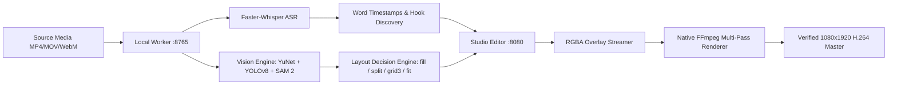

# ClipForge System Architecture

## 1. High-Level Component Topology

## 2. Module Responsibilities

- **`src/components/Studio.tsx`**: Orchestrates the 3-stage automated pipeline (transcription, viral clip discovery, and hybrid object/speaker tracking) and hosts the interactive 9:16 canvas editor.
- **`local_worker/openshorts_engine.py`**: Implements `OpenShortsSpeakerTracker`, `OpenShortsSmoothedCameraman`, `OneEuroFilter`, scene cut detection, and mouth/audio active-speaker attribution.
- **`local_worker/layout_decision.py`**: Evaluates candidate layouts (`fill`, `split`, `fit`) using weighted scores (visibility 25%, preservation 25%, confidence 15%, balance 15%, editorial relevance 10%, resolution 10%) with hard safety vetoes for overlapping panels.
- **`local_worker/rendering/renderer.py`**: Executes multi-pass FFmpeg filtergraphs with `-nostdin` isolation, per-frame `sendcmd` crop trajectories, and single-pass full-clip audio normalization.
