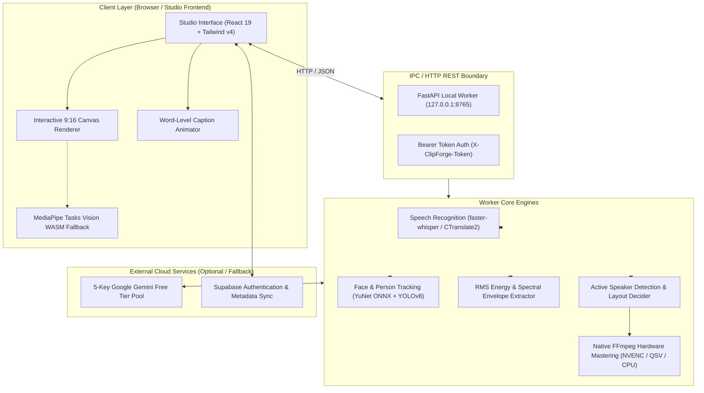
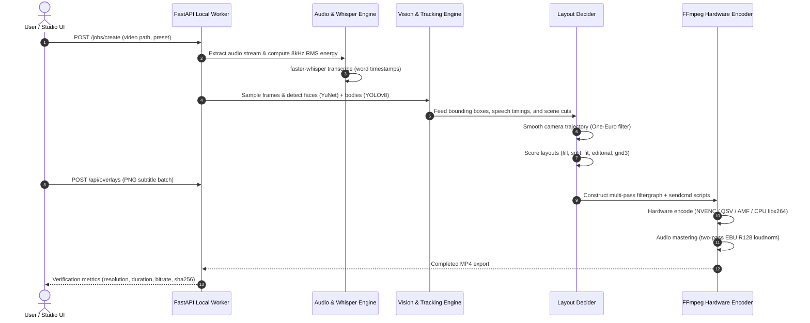

# ClipForge Studio — Architecture Audit & System Specification

**Project:** ClipForge Studio (`clipforge-studio`)  
**Lead Architect & Maintainer:** Minuja Ranthika Amarasekara (`2024is008-source`)  
**Target Repository:** `https://github.com/2024is008-source/clipforge-studio.git`  
**Audit Date:** 2026-11-14  

---

## 1. System Overview

ClipForge Studio is a high-performance, hybrid desktop/browser architecture engineered to transform standard 16:9 widescreen video into optimized 9:16 vertical shorts, reels, and clips. The platform couples a responsive, client-side web studio with a dedicated local GPU worker service, delivering real-time interactive previews alongside bit-accurate native FFmpeg exports.

---

## 2. Component Architecture Deep-Dive

### 2.1 Frontend Studio (`apps/frontend/` & `src/`)
- **Framework & Routing**: Built on **TanStack Start** (`@tanstack/react-start`) with **TanStack Router** using type-safe routing trees (`src/routeTree.gen.ts`).
- **State Management & UI**: React 19.2, Tailwind CSS v4, Radix UI primitives (`src/components/ui/`), and Lucide icons.
- **Unified Preview & Caption Pipeline (`src/lib/render.ts`, `src/lib/subtitles.ts`, `src/lib/render-overlays.ts`)**:
  - Implements word-level subtitle kinetic typography across presets (`opus`, `beast`, `karaoke`, `bounce`, `typewriter`, `glow`, `reveal`, `minimal`).
  - Supports transparent PNG overlay batching rendered into worker memory (`/api/overlays`) for frame-synchronized native FFmpeg compositing.
- **Client-Side Vision Fallback (`src/lib/reframe.ts`)**:
  - Employs Google MediaPipe Tasks Vision (`blaze_face_short_range.tflite`, `efficientdet_lite0.tflite`) via WASM with GPU delegate fallback to CPU when the local GPU worker is unavailable or in remote browser mode.

### 2.2 Local Worker Architecture (`workers/local_worker/` & `local_worker/`)
- **FastAPI Service (`local_worker/main.py`)**:
  - Runs on `http://127.0.0.1:8765` using Uvicorn.
  - Protected by Bearer token authentication (`X-ClipForge-Token`).
  - Endpoints cover `/health`, `/analyze`, `/transcribe`, `/render`, `/api/overlays`, and `/jobs`.
- **Speech Transcription Engine (`local_worker/whisper_engine.py`)**:
  - Uses `faster-whisper` backed by CTranslate2.
  - Automatically selects `int8_float16` on CUDA-capable GPUs or `int8` across all CPU cores.
  - Extracts word-level timestamps with BPE continuation token merging and monotonic timestamp validation.
- **Computer Vision & Face Tracking (`local_worker/detection_service.py`, `local_worker/openshorts_engine.py`)**:
  - OpenCV YuNet (`face_detection_yunet_2023mar.onnx`) for face detection.
  - Ultralytics YOLOv8n (`yolov8n.pt`) for human body and bounding box tracking.
  - Optional Meta AI SAM 2 (`local_worker/segmentation_service.py`) predictor adapter for pixel-perfect mask propagation.
- **Camera Smoothing (`SmoothedCameraman`)**:
  - 1-Euro adaptive low-pass filter to eliminate jitter.
  - Deadband thresholding to prevent micro-drifting during static shots.
  - 3-frame outlier jump rejection to prevent sudden accidental cuts.
  - Hard scene-cut snapping triggered by histogram correlation dips.
- **Active Speaker Attribution & Layout Decision (`local_worker/layout_decision.py`, `local_worker/speaker_priority.py`)**:
  - Correlates mouth vertical pixel variation with 8 kHz audio RMS energy envelopes.
  - Dynamically evaluates optimal vertical layouts:
    - `fill`: 1-up 9:16 crop tracking dominant speaker.
    - `split`: 2-up vertical stack for interview or conversation.
    - `grid3`: 3-up panel grid for panel shows or group discussions.
    - `editorial`: Context strip (wide shot) over speaker closeup.
    - `fit`: Blurred background with aspect-preserved video letterboxing.

---

## 3. Video Processing & Native FFmpeg Pipeline

---

## 4. Hardware Portability Matrix

| Accelerator Tier | Video Encoder | Whisper Device | Compute Type | Fallback Path |
|---|---|---|---|---|
| **NVIDIA RTX / GTX** | `h264_nvenc` | `cuda` | `float16` / `int8_float16` | Graceful switch to CPU |
| **Intel Core / Arc** | `h264_qsv` | `cpu` | `int8` (multi-threaded) | QSV encoding + CPU whisper |
| **AMD Radeon** | `h264_amf` | `cpu` | `int8` | AMF encoding + CPU whisper |
| **Apple Silicon** | `h264_videotoolbox`| `cpu` | `int8` | VideoToolbox + CPU whisper |
| **Generic CPU** | `libx264` | `cpu` | `int8` | Fully software-driven pipeline |

---

## 5. Security Architecture

1. **Authentication Boundary**: Protected worker endpoints enforce Bearer authentication via `X-ClipForge-Token` or `Authorization: Bearer <token>`.
2. **Path Traversal Protection**: All file path parameters are normalized through strict safe path checks ensuring operations are confined to designated scratch and project boundaries.
3. **Subprocess Isolation**: External invocations (`ffmpeg`, `ffprobe`) strictly specify `stdin=subprocess.DEVNULL`, use non-shell execution lists, and enforce `-nostdin`.
4. **Secret Management**: Google Gemini Free Tier keys (`GEMINI_API_KEY_1` through `5`) and Supabase credentials reside exclusively in local uncommitted `.env` files, read via `os.environ`.
