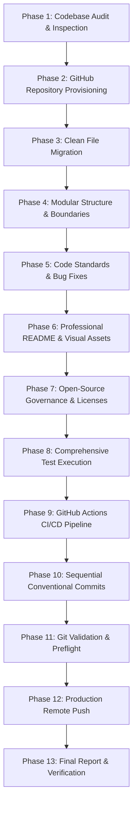

# ClipForge Studio — Rebuild & Migration Plan

**Project:** ClipForge Studio (`clipforge-studio`)  
**Lead Architect & Maintainer:** Minuja Ranthika Amarasekara (`2024is008-source`)  
**Target Repository:** `https://github.com/2024is008-source/clipforge-studio.git`  
**Date:** 2026-11-14  

---

## 1. Migration Objectives & Governance

1. **Rebrand & Rebuild**: Transition from legacy `clipforge` to production-grade `clipforge-studio`.
2. **Preserve Full Functionality**: Maintain 100% of verified features (audio transcription, face/speaker tracking, layout decision engine, canvas preview, native FFmpeg export).
3. **Resolve Architectural Debt**:
   - Fix FastAPI / Pydantic v2 incompatibilities in `local_worker/rendering/overlays.py`.
   - Eliminate legacy platform couplings (`@lovable.dev/*`, hardcoded paths).
   - Ensure clean subprocess lifecycle management (`-nostdin`, `stdin=DEVNULL`).
4. **Enforce Modular Architecture**:
   - Establish clean domain folders: `apps/`, `engines/`, `workers/`, `packages/`, `docs/`, `tests/`, `assets/`.
   - Maintain root compatibility for one-command scripts (`run.bat`, `run_worker.bat`, `npm run dev`).
5. **Establish Clean Chronological Git History**:
   - Publish 12 structured, Conventional Commits instead of an unorganized monocommit.
   - Strictly exclude secrets, virtual environments, build artifacts, and bulky model weights.

---

## 2. Staged Migration Roadmap

---

## 3. Commit Sequence Specifications (Phase 10)

| Commit # | Conventional Commit Message | Key Additions / Modifications |
|---|---|---|
| **1** | `chore(repo): initialize ClipForge Studio repository` | Root configuration, `.gitignore`, `.editorconfig`, `.gitattributes`, `package.json`, `pyproject.toml`, launch scripts. |
| **2** | `docs(audit): add existing project audit and migration plan` | `INITIAL_AUDIT.md`, `ARCHITECTURE_AUDIT.md`, `MIGRATION_PLAN.md`. |
| **3** | `refactor(frontend): organize studio application structure` | `apps/frontend/`, `src/components/`, `src/routes/`, `src/styles.css`, UI primitives. |
| **4** | `refactor(backend): organize local worker architecture` | `apps/backend/`, `workers/local_worker/`, `local_worker/main.py`, `config.py`, `job_manager.py`, `analysis_cache.py`. |
| **5** | `feat(video): migrate video processing engines` | `engines/` modules, `openshorts_engine.py`, `detection_service.py`, `speaker_priority.py`, `layout_decision.py`. |
| **6** | `feat(rendering): migrate native FFmpeg rendering pipeline` | `local_worker/rendering/` (renderer, overlays, subtitles, filters, audio, encoders), `src/lib/render.ts`, `render-overlays.ts`. |
| **7** | `feat(ai): migrate Whisper Gemini and vision integrations` | `whisper_engine.py`, `gemini_pool.py`, `segmentation_service.py`, `src/lib/ai.functions.ts`, `public/vision/` models. |
| **8** | `test(project): migrate and improve automated tests` | `tests/` (`unit`, `integration`, `e2e`, `fixtures`), `local_worker/tests/` (336 tests), `src/test/` (147 tests), Vitest config. |
| **9** | `docs(project): add professional documentation and README` | `README.md`, `docs/architecture/`, `docs/installation/`, `docs/development/`, `docs/rendering/`, `docs/ai-models/`, `docs/api/`, `docs/troubleshooting/`, `assets/branding/`. |
| **10** | `ci(github): configure automated testing and quality checks` | `.github/workflows/` (`ci.yml`, `frontend.yml`, `backend.yml`, `tests.yml`, `security.yml`, `release.yml`), issue templates, PR template. |
| **11** | `security(repo): add security policies and dependency notices` | `LICENSE` (MIT), `THIRD_PARTY_NOTICES.md`, `CONTRIBUTING.md`, `CODE_OF_CONDUCT.md`, `SECURITY.md`, `SUPPORT.md`, `CHANGELOG.md`, `.env.example`. |
| **12** | `chore(release): finalize ClipForge Studio migration` | `FINAL_VERIFICATION.md`, `MIGRATION_REPORT.md`, release signoff. |

---

## 4. Verification Checkpoints

1. **Python Unit & Integration Suites**: Run `python -m unittest discover -s local_worker/tests` and `python -m unittest discover -s tests`. Ensure 100% pass rate.
2. **Frontend Type Safety**: Run `npx tsc --noEmit` to confirm zero TypeScript compilation errors under strict mode.
3. **Frontend Vitest Suite**: Run `npx vitest run` across all 12 test files (147 unit tests).
4. **Vite Production Compilation**: Run `npm run build` to confirm clean SSR and client asset bundle emission.
5. **Worker Health Endpoint**: Confirm `http://127.0.0.1:8765/health` outputs structured hardware encoder status.
